 

## About

Tech Lead with 4 years of TypeScript experience, building business software that runs real operations: transport, distribution, HR, and payments. I lead a team of 3 developers across 5 business systems, and take products from database design to production.

**Focus:** multi-tenant architectures, payments, and Redis.

**Languages:** French (native), English (fluent)

- **Now:** Tech Lead and Digitalization Project Manager, plus freelance lead developer
- **Founder and CTO:** [PermisGo](https://www.permisgo.tg/), a B2B2C SaaS that digitalizes driving schools, with mobile money and card payments
- **How I lead:** code reviews, mentoring, technical specs, and ADRs

## Impact

## Selected work

| System | What I delivered |
| :--- | :--- |
| **Transport management (TMS)** | Digitalized all business logic. Manual tasks down from 90% to 10%, 25 daily users, 500M+ FCFA (~€760k) of transactions tracked monthly |
| **Multi-store ERP** | 2 stores and 4 warehouses, ~98M FCFA (~€150k) of sales tracked, reporting and SYSCOHADA accounting |
| **Multi-company HRIS** | Self-service for 195 employees of a group and its 2 subsidiaries, from HR records to payroll and payslips |
| **Government platforms** | Secure interfaces, including tax calendars and data tables, for land and tax systems |
| **Ride-hailing app** | React Native front-end lead, optimized real-time geolocation |
| **Mobile apps** | 6 iOS and Android apps with online payments, premium subscriptions, and "Proof of Life" identity verification |
| **CMS and SaaS** | 8 custom CMS and a networking SaaS platform |
| **Offline-first desktop app** | Windows and macOS MVP with local and remote sync and license management |
| **Event kiosk** | Interactive kiosk using facial recognition to distribute photos automatically |

## Tech stack

## GitHub activity

Most of my work lives in private repositories.

<picture>
  <source media="(prefers-color-scheme: dark)" srcset="assets/snake-dark.svg" />
  <source media="(prefers-color-scheme: light)" srcset="assets/snake.svg" />
  
</picture>

<strong>Version française</strong>

 

Tech Lead avec 4 ans d'expérience en TypeScript. Je conçois des logiciels métier au service d'opérations réelles : transport, distribution, RH et paiements. J'encadre une équipe de 3 développeurs sur 5 logiciels métier et je mène les produits de la modélisation de la base de données à la production.

**Spécialités :** architectures multi-tenant, paiements et Redis.

- **Aujourd'hui :** Tech Lead et Chef de Projet Digitalisation, et lead développeur freelance
- **Fondateur et CTO :** [PermisGo](https://www.permisgo.tg/), SaaS B2B2C de digitalisation des auto-écoles, avec paiements mobile money et carte
- **Encadrement :** code review, mentorat, specs techniques et ADR

**Réalisations**

- **TMS transport :** toute la logique métier digitalisée, tâches manuelles réduites de 90 % à 10 %, 25 utilisateurs quotidiens, plus de 500 M FCFA (~760 k€) de transactions tracées par mois
- **ERP multi-boutiques :** 2 boutiques et 4 entrepôts, ~98 M FCFA (~150 k€) de ventes tracées, reporting et comptabilité SYSCOHADA
- **SIRH multi-sociétés :** self-service pour 195 employés d'un groupe et de ses 2 filiales, du dossier RH à la paie et aux bulletins de salaire
- **Plateformes gouvernementales :** interfaces sécurisées, dont calendriers fiscaux et tableaux de données, pour des systèmes foncier et fiscal
- **Application VTC :** lead front-end React Native, optimisation de la géolocalisation en temps réel
- **Applications mobiles :** 6 applications iOS et Android avec paiements en ligne, abonnements premium et vérification d'identité « Proof of Life »
- **CMS et SaaS :** 8 CMS sur mesure et une plateforme SaaS de networking
- **Application desktop offline-first :** MVP Windows et macOS avec synchronisation locale et distante et gestion de licences
- **Borne événementielle :** borne interactive avec reconnaissance faciale pour distribuer automatiquement les photos

**Langues :** français (natif), anglais (courant)

 

